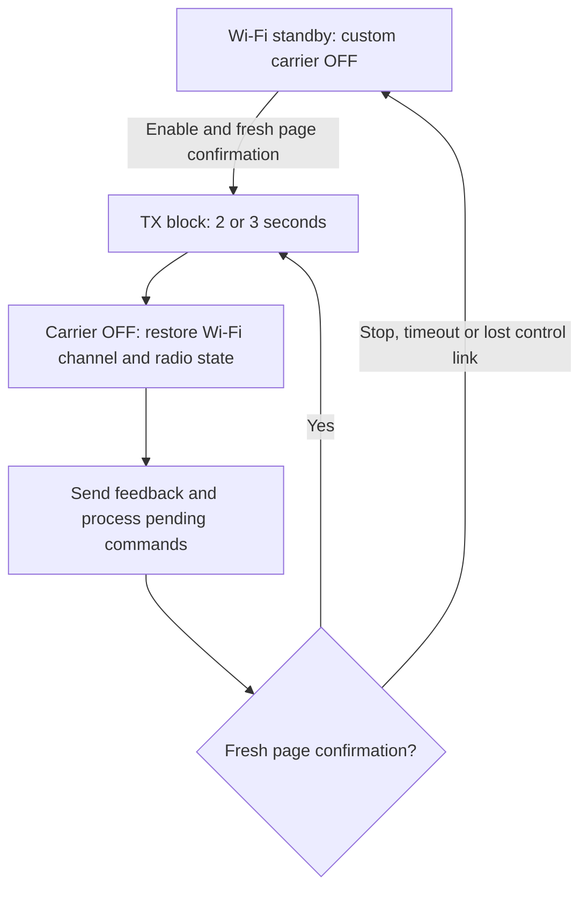

# ESPBoOm8266TX

**A browser-controlled 2.4 GHz RF test carrier generator for the ESP8266.**

ESPBoOm8266TX hosts its own web interface and shares the ESP8266's single radio between ordinary Wi-Fi control and custom PHY transmission. It emits at a selected nominal frequency, gates the carrier with an adjustable duty cycle, and regularly returns to Wi-Fi to report its status and receive commands.

The project is provided as **one standalone Arduino sketch**, with the HTML, CSS, JavaScript and project code embedded in [ESPBoOm8266TX.ino](ESPBoOm8266TX/ESPBoOm8266TX.ino). No separate web files, filesystem upload or additional Arduino libraries are required beyond the ESP8266 Arduino core.

This README documents firmware **0.2.0**. This version generates a single gated carrier; user-defined data frames and payload modulation are not implemented.

## Radio regulations and responsible use

**Before enabling transmission, check and follow the laws, radio regulations and technical standards in force in your country.** Consult your national spectrum authority about permitted frequencies, emission types, power/EIRP, antennas, occupied bandwidth, unwanted emissions, RF exposure, duty-cycle restrictions and any required authorization or equipment approval.

The software's frequency range and duty-cycle limit do not establish permission to transmit. Do not assume that a module's approval for normal Wi-Fi operation covers this modified PHY mode. For example, Canada's [ISED RSS-Gen](https://ised-isde.canada.ca/site/spectrum-management-telecommunications/en/devices-and-equipment/radio-equipment-standards/radio-standards-specifications-rss/rss-gen-general-requirements-compliance-radio-apparatus) addresses equipment modifications and compliance; use the rules applicable to your own jurisdiction.

Use an appropriate controlled test setup, such as a shielded enclosure or a properly terminated conducted setup where supported by the hardware. Avoid interference with other users and stop transmitting if interference occurs. ASK and APWR are raw control codes, so external RF measurements are needed to establish actual output power and compliance.

## Features

- Embedded English web interface with controls in the left panel.
- Nominal carrier tuning from **2412 to 2462 MHz**, in **1 MHz steps**.
- Separate **ASK** and **APWR** hardware control codes.
- Adjustable **0–90% RF duty cycle** and **2–100 ms pulse period**.
- **2- or 3-second TX blocks**, separated by Wi-Fi control windows.
- Explicit Enable/Stop controls and fresh browser confirmation before each RF block.
- Feedback for applied settings, completed blocks, duty-cycle timing and radio restoration faults.
- Plain **HTTP on port 80** and **WebSocket on port 81**.
- Custom transmission remains **OFF at boot** and never resumes automatically after a page reconnection.

## How it works

The ESP8266 cannot serve Wi-Fi traffic and generate this custom carrier simultaneously. The firmware alternates between the two uses of its radio:



Before borrowing the radio, the firmware signals power-management intent to the access point. It then saves the relevant radio state and tunes to the requested carrier frequency. During the TX block, Timer1 interrupts switch the RF gate ON and OFF; Wi-Fi processing is deferred.

At the end of the block, the carrier is switched OFF, the Wi-Fi home channel and radio state are restored, and the firmware signals its return to the access point. It services pending commands, sends feedback and requests a fresh confirmation from the browser before another RF block can begin.

The intention is to preserve the Wi-Fi association while temporarily using the PHY for custom transmission. This implementation has not been certified for IEEE 802.11 power-save compliance, and connection behavior depends on the access point and link conditions.

### Two independent timing controls

**RF pulse timing** controls the carrier inside a TX block. With a 10 ms period and 10% duty cycle, the requested pattern is:

```text
1 ms carrier ON + 9 ms carrier OFF, repeated during the TX block
```

These short OFF intervals do not service Wi-Fi. The radio remains in the custom TX session until the block ends.

**Page confirmation interval** selects a 2- or 3-second RF block. After each block, the carrier stays OFF while the ESP returns to Wi-Fi, handles commands and waits for the page. Radio switching, network traffic and retries add time, so the interval between block starts is longer than the selected block duration.

### Duty cycle and chip heating

The duty cycle reduces the carrier's average ON time to help limit heating. Wi-Fi control pauses provide additional time with the custom carrier OFF. A higher duty cycle increases carrier ON time; it does not increase the selected carrier's instantaneous power.

Start with a low duty cycle and short tests, provide adequate ventilation and monitor the hardware temperature. The firmware does not measure temperature or provide temperature-based shutdown. The 90% software limit is not a thermal safety rating, and long-duration thermal operation has not been qualified.

### Browser confirmation and stopping

Only clicking **Enable transmission** arms a session. At each Wi-Fi window, the ESP sends a challenge tied to that page, session and cycle. A matching, one-use reply is required before the next RF block.

The confirmation wait is **up to 3000 ms**, with the carrier OFF throughout the wait. A missing or expired confirmation ends the session. Simply reading status does not renew transmission permission. Reopening the page or reconnecting the socket requires another explicit Enable.

**Stop transmission** immediately disarms further confirmations in the page, but the ESP processes the request when it returns to Wi-Fi. It may finish the current 2- or 3-second block first, and network delays can extend feedback latency. The button is not an instantaneous hardware interlock; disconnect power if immediate physical shutdown is required.

## Hardware and build requirements

The validated build uses an ESP8266 board with **4 MB flash**, configured as a **LOLIN/WEMOS D1 mini**:

| Build setting | Validated value |
|---|---|
| ESP8266 Arduino core | 3.1.2 |
| CPU frequency | 160 MHz |
| Flash layout | 4 MB / 1 MB filesystem (`4M1M`) |
| lwIP | v2 Higher Bandwidth (`hb2f`) |
| SDK and MMU | Core defaults; 32 KB cache / 32 KB IRAM |
| C and C++ optimization | `-O3` |

Use a stable power supply, a USB cable suitable for programming, an existing 2.4 GHz Wi-Fi access point and a modern browser. A receiver or spectrum analyzer is optional for observing the emitted carrier; it is not required for the control page.

Low-level radio behavior depends on the SDK and memory layout. Use the validated build configuration before experimenting with other boards or core versions.

## Installation

1. Install **ESP8266 Arduino core 3.1.2**, following the [official installation instructions](https://arduino-esp8266.readthedocs.io/en/3.1.2/installing.html).
2. Keep the sketch in a matching folder:

   ```text
   ESPBoOm8266TX/
   └── ESPBoOm8266TX.ino
   ```

3. Set your SSID and password in the existing `SDR_WIFI_SSID` and `SDR_WIFI_PASSWORD` definitions. See **Wi-Fi and network configuration** below for the exact locations.
4. Set the static IP address, gateway and subnet mask in `WiFi.config(...)`, as explained below. Choose an unused address that matches your LAN. This firmware joins an existing access point; it does not create its own Wi-Fi network or obtain its address through DHCP.
5. Select the board and build settings above, then compile and upload to the intended transmitter.
6. Connect your browser device to the same LAN and open **`http://192.168.1.38/`**, or the address you configured. Allow access to ports 80 and 81. No Internet connection is required during use.

For Arduino CLI, the validated compile command is:

```sh
arduino-cli compile --fqbn esp8266:esp8266:d1_mini:xtal=160,eesz=4M1M,ip=hb2f --build-property compiler.cpp.extra_flags=-O3 --build-property compiler.c.extra_flags=-O3 --output-dir bin ESPBoOm8266TX
```

The application does not print its IP address to the Serial Monitor. Use the configured static address. The control interface uses unencrypted HTTP/WebSocket without user authentication; operate it on a trusted local network.

### Wi-Fi and network configuration

All five settings are inside **`ESPBoOm8266TX/ESPBoOm8266TX.ino`**. Use your editor's Find command to locate the following text:

| Setting | Search for | What to change |
|---|---|---|
| Wi-Fi network name (SSID) | `#define SDR_WIFI_SSID` | The quoted network name |
| Wi-Fi password | `#define SDR_WIFI_PASSWORD` | The quoted password |
| ESP static IP address | `WiFi.config(` | The **first** `IPAddress(...)` argument |
| Gateway | `WiFi.config(` | The **second** `IPAddress(...)` argument |
| Subnet mask | `WiFi.config(` | The **third** `IPAddress(...)` argument |

The credential definitions are in the section marked `BEGIN integrated wifi_credentials.h`. Edit the existing definitions rather than adding another copy:

```cpp
#define SDR_WIFI_SSID "YOUR_WIFI_SSID"
#define SDR_WIFI_PASSWORD "YOUR_WIFI_PASSWORD"
```

The network configuration is in `namespace DirectSession`, inside its `begin()` function. The existing call uses these defaults, shown here on separate lines for clarity:

```cpp
WiFi.config(
    IPAddress(192, 168, 1, 38), // ESP static IP address
    IPAddress(0, 0, 0, 0),      // Gateway
    IPAddress(255, 255, 255, 0) // Subnet mask
);
```

The argument order is **IP address, gateway, subnet mask**. Write IPv4 octets with commas inside `IPAddress(...)`. Set values appropriate to your own network; for example, if your router is `192.168.1.1`, that can be your gateway. The supplied `0.0.0.0` gateway is for local-subnet access without a configured route to other networks.

Recompile and upload after changing any of these settings.

### HTTP and WebSocket addresses after an IP change

If the ESP IP changes, use the new address for **both** HTTP and WebSocket connections:

| Connection | Default | Example with ESP IP changed to `192.168.1.50` |
|---|---|---|
| Web page | `http://192.168.1.38/` | `http://192.168.1.50/` |
| Control WebSocket | `ws://192.168.1.38:81/ws` | `ws://192.168.1.50:81/ws` |

**The embedded page handles this automatically:** the firmware builds the WebSocket URL from `WiFi.localIP()`, and the browser also has a fallback using the page's hostname. There is no second fixed IP address to edit in the embedded HTML for normal use. Open the page at the ESP's new HTTP address after uploading the changed configuration.

If you use a separate script, saved WebSocket URL or external client, update its `ws://` address yourself. Keep **port `81`** and **path `/ws`**. The browser page and its control socket must point to the same ESP host.

**Before publishing source or binaries, replace private Wi-Fi credentials with placeholders. Compiled firmware also contains the configured credentials.**

## Using the web interface

1. Open the page and wait for **Connected** and **Wi-Fi standby**. Loading the page does not enable the custom carrier.
2. Set the requested frequency, ASK, APWR, duty cycle, pulse period and page confirmation interval.
3. Click **Apply settings**. All changes, including ASK/APWR slider movements, require this button in the documented version.
4. Click **Enable transmission**. Keep the controlling page open and active so it can answer confirmation challenges.
5. Observe the applied values, completed TX blocks and timing feedback. Use an external receiver or RF instrument to verify the actual signal.
6. To change settings during transmission, edit them and click **Apply settings**. The ESP processes the request at a Wi-Fi window; an RF block already in progress keeps its current settings. Check the applied values and revision feedback after the subsequent block.
7. Click **Stop transmission** and wait for the stopped/standby feedback. Closing the page also removes further authorization, but is not a substitute for confirming a deliberate Stop.

Browser suspension, device sleep or loss of Wi-Fi may prevent confirmation and stop the session. Reconnect, check the displayed state and explicitly enable again when ready.

### Controls

| Control | Accepted values | Default | Meaning |
|---|---|---|---|
| Requested frequency | 2412–2462 MHz, step 1 MHz | 2412 MHz | Nominal custom carrier frequency; independent of the access point's home channel |
| ASK | 0–63 | 63 | Digital amplitude control code; 0 is strongest in the documented scale |
| APWR | 0–127 | 63 | Raw analog power-control selector |
| RF duty during TX blocks | 0–90%, step 1% | 10% | Requested carrier ON fraction within each RF block |
| RF pulse period | 2–100 ms, step 1 ms | 10 ms | Duration of one ON/OFF cycle |
| Page confirmation interval | 2 or 3 seconds | 2 seconds | RF block length before returning to Wi-Fi |

**ASK and APWR are not dBm values or a linear power scale.** ASK and APWR are set separately; APWR codes 0–63 share the same analog baseline in this implementation. There are not 128 distinct calibrated analog power levels. ASK 63 is not an OFF command: use Stop or a 0% duty setting to stop the session.

### Reading the feedback

- **Applied settings** describe the configuration used by the last completed RF block. Newly accepted settings can remain pending until a block completes.
- **Timed duty within TX blocks** is the firmware's carrier-gate ON time divided by block time.
- **Global duty including Wi-Fi pauses** includes the session's control and switching pauses, so it is generally lower than the within-block duty.
- **Non-TX time** includes time outside custom carrier emission; it is not a measurement of CPU sleep or chip cooling.
- **Emission feedback** reports transmitter activity, not successful reception at a remote device.

Timer latency can affect very short pulses. Displayed duty values are software timing observations, not independently calibrated measurements of the RF envelope.

## Faults and troubleshooting

| Symptom | What to check |
|---|---|
| Page does not load | Wi-Fi credentials, static address/subnet, address conflicts, power and LAN access to port 80 |
| Page loads but control is unavailable | WebSocket access to port 81; open the page over HTTP |
| Enable is unavailable | Wait for the control connection, apply pending settings, use nonzero duty and resolve any reported fault |
| Settings do not change immediately | Click Apply settings and allow the current RF block and next Wi-Fi exchange to finish |
| Transmission stops unexpectedly | Page availability, browser sleep, Wi-Fi link quality, confirmation timeout and fault feedback |
| No carrier seen on a receiver | Applied frequency/codes, nonzero duty, receiver coverage and capture timing; short snapshots may miss ON pulses |

During Wi-Fi recovery the custom carrier remains OFF. Radio guard faults block further transmission; failure to restore critical radio state causes the firmware to gate the carrier OFF and reset. After a fault, investigate the cause before restarting and enabling again.

## Validation and limits

The reference build has passed compilation, configuration/parser checks, browser-control tests, hardware timing checks and a bounded browser-controlled endurance test. Independent OFF/ON/OFF receiver observations detected an RF increase associated with transmission. The standalone sketch compiled to the same binary as the validated reference firmware.

These checks do not establish calibrated output power, absolute frequency accuracy, remote payload delivery, long-duration thermal safety or regulatory certification. Use suitable external instruments for RF measurements.

## Credits and third-party notices

The radio work builds on [kaboom748/esp8266_WLAN_PHY](https://github.com/kaboom748/esp8266_WLAN_PHY) and the ESPBoOm8266 receiver/session implementation.

The embedded WebSocket transport includes adaptations from [Links2004/arduinoWebSockets 2.7.2](https://github.com/Links2004/arduinoWebSockets/tree/2.7.2), Copyright (c) 2015 Markus Sattler, licensed under LGPL-2.1-or-later. Its notices and license text are retained inside the standalone sketch; preserve them when redistributing it.

