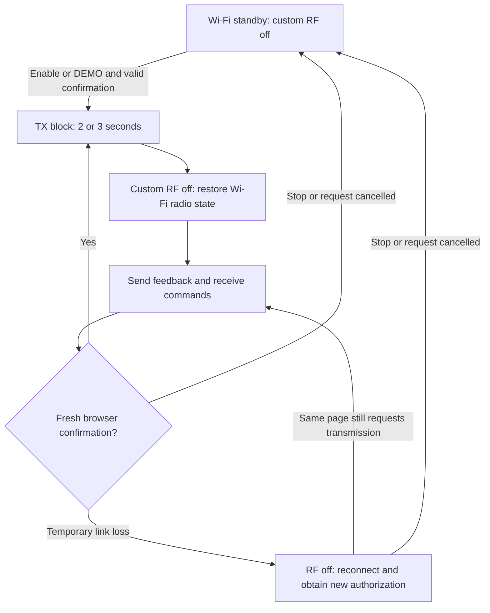

# ESPBoOm8266TX

**An ESP8266 RF test transmitter with a web interface and an editable waterfall drawing generator.**

ESPBoOm8266TX generates a gated 2.4 GHz carrier or scans a drawing across RF frequencies so that it appears in a separate receiver's waterfall. The ESP hosts the complete English interface and alternates its single radio between custom PHY transmission and ordinary Wi-Fi control.

This guide covers **[ESPBoOm8266TX_V2.ino](ESPBoOm8266TX_V2.ino), firmware 0.4.0**. The page, radio engine and drawing storage are integrated into one standalone Arduino sketch.

## Choose a version

| File | Firmware | Description |
|---|---|---|
| **[ESPBoOm8266TX_V2.ino](ESPBoOm8266TX_V2.ino)** | **0.4.0** | Current version: manual carrier, DEMO, pixel editor, saved drawings and automatic recovery of an ongoing browser request |
| [ESPBoOm8266TX_V1.ino](ESPBoOm8266TX_V1.ino) | 0.2.0 | Earlier single-carrier implementation; its session behavior differs from V2 |

Use **V2** for the features described below. Keep the two sketches in separate Arduino project folders.

## Features

- Manual carrier tuning from **2412 to 2462 MHz**, in **1 MHz steps**.
- Independent **ASK** and **APWR** control codes.
- Hardware-timed RF gating: **0–90% duty cycle**, with a **2–100 ms pulse period**.
- **2- or 3-second TX blocks**, with Wi-Fi feedback and fresh browser confirmation between blocks.
- An ongoing transmission request with **no fixed total session duration**, while the controlling page remains open and responsive.
- Repeating **DEMO** drawing: ESP-SDR text, a rectangle, a circle and five vertical bars.
- A **321 × 288 pixel editor** with Draw, Erase, Pan, Zoom, Fit, Undo/Redo, Clear and Restore original.
- **Apply drawing** to save an image, including during an active session.
- LittleFS persistence for the last accepted drawing.
- Adjustable drawing cadence: **50–5000 ms per logical row**.
- Plain **HTTP, port 80**, and **WebSocket, port 81**. No HTTPS setup is required.

Manual mode produces a carrier with ON/OFF gating. DEMO rapidly scans the frequencies assigned to the drawing's bright pixels. User-defined data frames and payload modulation are not implemented.

## Radio regulations

**Before transmitting, follow the laws, radio regulations and technical standards applicable in your country.** Check permitted frequencies, emission types, power/EIRP, antennas, occupied bandwidth, unwanted emissions, duty restrictions and any required authorization or equipment approval with your national spectrum authority.

The firmware's limits do not grant permission to transmit or certify compliance. Do not assume that approval of a module for normal Wi-Fi operation covers this modified PHY mode. Use a controlled test setup, avoid interference and stop transmission if interference occurs. ASK/APWR codes are not calibrated power measurements.

## How transmission and Wi-Fi alternate

The ESP8266 uses the same radio for the control connection and custom transmission:



Before borrowing the radio, the firmware signals power-management intent to the access point and saves the radio state. Timer1 gates the carrier during the TX block. Afterward, the firmware turns the carrier off, restores the Wi-Fi home channel and saved state, and services control traffic.

This aims to retain the Wi-Fi association while the radio is temporarily occupied. It is not a certification of IEEE 802.11 power-save compliance. Network conditions and access-point behavior can extend the Wi-Fi pauses.

### Three separate timing settings

| Setting | What it controls |
|---|---|
| **RF duty and pulse period** | ON/OFF gating inside a TX block |
| **Page confirmation interval** | A 2- or 3-second TX block before returning to Wi-Fi |
| **Row time** | Progress through the DEMO drawing |

For example, a **10 ms period at 10% duty** requests approximately **1 ms ON followed by 9 ms OFF** within a TX block. These short OFF portions do not service Wi-Fi; control traffic is handled after the block.

The selected duty applies within TX blocks. Overall carrier duty also includes Wi-Fi and switching pauses, so it is generally lower. An ongoing session therefore contains repeated TX blocks and real RF gaps.

### Duty cycle and heating

Duty gating reduces average carrier ON time to help limit chip heating. Wi-Fi windows add further time with the custom carrier off. Increasing duty does not increase instantaneous carrier power.

Start with low duty and short tests, use a suitable power supply and monitor temperature. There is **no temperature sensor or temperature-based shutdown in this application**. The 90% software cap is not a thermal safety guarantee.

### Browser authorization and stopping

Click **Enable transmission** once for an ongoing manual-carrier request, or **DEMO** to request the drawing. Keep the same controlling page open and responsive. Each new RF block requires a fresh, one-use confirmation tied to that page, session and cycle. Reading status alone does not renew authorization.

The confirmation wait is up to **3000 ms**, with custom RF off. During a temporary connection loss, the same page retains its request and can reconnect, obtain fresh authorization and resume. A suspended browser or sleeping computer can prevent this exchange and leave RF off.

**Stop transmission**, a Stop received from another client, zero duty, a radio fault, an ESP reboot, closing the page or reloading it cancels the request. A new page does not automatically adopt a previous session. A cancelled request requires another explicit Enable or DEMO action.

Stop immediately disarms further confirmations in the browser. The ESP processes the command when it returns to Wi-Fi, so an RF block already running may finish first. Wait for stopped/standby feedback; this button is not an instantaneous hardware interlock.

## Hardware and build

The validated configuration uses an ESP8266 with **4 MB flash**, selected as a **LOLIN/WEMOS D1 mini**:

| Setting | Validated value |
|---|---|
| ESP8266 Arduino core | **3.1.2** |
| CPU | **160 MHz** |
| Flash / filesystem | **4 MB / 1 MB FS**, `4M1M` |
| lwIP | **v2 Higher Bandwidth**, `hb2f` |
| SDK and MMU | Core defaults; 32 KB cache / 32 KB IRAM |
| C and C++ optimization | **`-O3`**, applied by the CLI command below |
| Erase mode for retaining drawings | **Only Sketch** |

Use an existing 2.4 GHz Wi-Fi access point and a modern browser. A separate receiver or spectrum analyzer is needed to observe the transmitted RF; it is not required to operate the control page.

No additional Arduino libraries are required beyond the ESP8266 core. LittleFS is included with the core. No separate HTML, filesystem image or filesystem upload plugin is needed.

### Installation

1. Install **ESP8266 Arduino core 3.1.2** using the [official installation guide](https://arduino-esp8266.readthedocs.io/en/3.1.2/installing.html).
2. Download **[ESPBoOm8266TX_V2.ino](ESPBoOm8266TX_V2.ino)**. Copy it into a folder named `ESPBoOm8266TX` and rename the copy to `ESPBoOm8266TX.ino`:

   ```text
   ESPBoOm8266TX/
   └── ESPBoOm8266TX.ino
   ```

   Put only the selected sketch in that folder. Arduino compiles all `.ino` files in a sketch folder, so placing V1 and V2 together causes duplicate definitions.

3. Configure SSID, password, static IP, gateway and subnet mask as described below.
4. Build with the validated settings and upload to the intended transmitter.
5. Open **`http://192.168.1.38/`**, or your configured address, from the same LAN. The application does not announce its IP through the Serial Monitor.
6. Wait for connected/standby feedback before requesting transmission. Boot leaves custom RF off; opening the page does not automatically start transmission.

Validated Arduino CLI compile command, run from the parent of the sketch folder:

```sh
arduino-cli compile --fqbn esp8266:esp8266:d1_mini:xtal=160,eesz=4M1M,ip=hb2f --build-property compiler.cpp.extra_flags=-O3 --build-property compiler.c.extra_flags=-O3 --output-dir bin ESPBoOm8266TX
```

To retain a saved drawing during later uploads, keep the same **4 MB / 1 MB FS** layout and select **Only Sketch**. A full erase, filesystem-image upload or partition change can remove it. A blank filesystem partition is initialized automatically; an unrecognized nonblank partition is not automatically formatted.

## Wi-Fi and network configuration

Edit the selected INO before compiling. Use Find to locate the existing definitions and configuration call:

| Setting | Search for | Edit |
|---|---|---|
| SSID | `#define SDR_WIFI_SSID` | Quoted Wi-Fi network name |
| Password | `#define SDR_WIFI_PASSWORD` | Quoted Wi-Fi password |
| Static IP | `WiFi.config(` in `DirectSession::begin()` | First `IPAddress(...)` argument |
| Gateway | Same call | Second argument |
| Subnet mask | Same call | Third argument |

Replace the existing credential values; do not add duplicate definitions:

```cpp
#define SDR_WIFI_SSID "YOUR_WIFI_SSID"
#define SDR_WIFI_PASSWORD "YOUR_WIFI_PASSWORD"
```

The network call has this argument order: **IP address, gateway, subnet mask**. The supplied configuration is:

```cpp
WiFi.config(
    IPAddress(192, 168, 1, 38), // ESP static IP
    IPAddress(0, 0, 0, 0),      // Gateway
    IPAddress(255, 255, 255, 0) // Subnet mask
);
```

Choose an unused IP appropriate to your LAN. Set the gateway to your router's address if routing is needed; the supplied `0.0.0.0` configuration is intended for local-subnet access. The firmware joins an existing Wi-Fi network and uses this static configuration.

Recompile and upload after editing these values. Replace private credentials before publishing source or compiled firmware.

### Update HTTP and `ws://` addresses after changing IP

For a new device IP of `192.168.1.50`, use:

| Connection | Default | New example |
|---|---|---|
| Web page | `http://192.168.1.38/` | `http://192.168.1.50/` |
| Control socket | `ws://192.168.1.38:81/ws` | `ws://192.168.1.50:81/ws` |

**The embedded page updates its WebSocket destination automatically** from the device IP, with a page-hostname fallback. A normal static-IP change does not require editing or rebuilding the compressed HTML separately.

Update any saved `ws://` URL in an external script or client yourself. Keep **port 81** and **path `/ws`**. Use plain HTTP and `ws://` on a trusted local network: the interface is unencrypted and has no user-login authentication.

## Manual carrier operation

1. Open the page and wait for **Connected** and **Wi-Fi standby**.
2. Choose frequency, ASK, APWR, duty, pulse period and page confirmation interval.
3. Click **Apply settings**. Ordinary slider changes, including ASK and APWR, require this button.
4. Click **Enable transmission** and keep the controlling page responsive.
5. Check applied values and completed-block feedback. A setting accepted during transmission is applied at a Wi-Fi boundary; the current RF block retains its existing settings.
6. Click **Stop transmission** and wait for standby feedback.

| Control | Range | Default |
|---|---|---|
| Manual carrier frequency | 2412–2462 MHz, step 1 MHz | 2412 MHz |
| ASK | 0–63 | 63 |
| APWR | 0–127 | 63 |
| RF duty | 0–90%, step 1% | 10% |
| Pulse period | 2–100 ms, step 1 ms | 10 ms |
| Page confirmation interval | 2 or 3 seconds | 2 seconds |
| DEMO row time | 50–5000 ms, step 1 ms | 1000 ms |

ASK 0 is strongest in the implemented scale. **ASK 63 is not an OFF command**; use Stop or zero duty. ASK/APWR are raw codes, not dBm or a linear power scale. APWR 0–63 share the same analog baseline in this implementation; the range does not represent 128 distinct calibrated power levels.

## DEMO and pixel editor

### Edit and save a drawing

The editor loads the original image on a device without a saved drawing, or the last accepted custom image from the ESP. Loading it does not start transmission.

1. Select **Draw** or **Erase** and drag over the canvas. Right-click also erases.
2. Use **Zoom** for individual pixels. Use **Pan**, the middle mouse button or scrollbars to move the view; **Fit** fits it to the available width.
3. Use **Undo/Redo**, or Ctrl+Z / Ctrl+Shift+Z with the canvas focused. A drag is one editing action.
4. Keep each horizontal pixel row within **24 enabled points**. Overfull rows are highlighted and cannot be applied. A completely empty drawing is also rejected.
5. **Clear** and **Restore original** change the local draft. They do not immediately save or transmit it.
6. Click **Apply drawing** to upload and save a valid draft. Alternatively, click **DEMO** to upload pending edits, verify them and select the drawing for transmission.

Editing alone leaves the device's existing drawing unchanged. During upload, custom RF is held off. The ESP checks the complete image and CRC before replacing the active drawing.

**Apply drawing does not start an idle transmitter.** If a session is already active, Apply temporarily pauses RF and resumes the existing request after a successful update and fresh confirmation. An incomplete or invalid upload leaves the previous verified drawing in place. If a commit reply is lost, the page reconnects and verifies the stored CRC before deciding whether to resend.

The last accepted image is stored in LittleFS and survives page reloads, ESP restarts and sketch-only uploads with the same partition layout. Local edits that have not been applied are not saved to the ESP. Saved drawings do not preserve an ON request: boot remains RF-off.

### Transmit the drawing

1. Apply the desired ASK, APWR, duty, pulse period and confirmation interval.
2. Set **Row time** in the left **Waterfall drawing** panel.
3. Click **DEMO**. From standby, this requests transmission after any drawing upload and the normal authorization exchange. In an owned active session, it switches from the manual carrier at a Wi-Fi boundary.
4. Keep the same page open. The pattern repeats while authorization continues.
5. Adjust Row time to match the receiving waterfall. With DEMO active, cadence changes apply automatically at the next Wi-Fi exchange and restart the pattern. With DEMO off, the value remains a local preview until activation.
6. Click **DEMO** again to return to the saved manual carrier frequency. **Turning DEMO off does not stop an active carrier session.** Use **Stop transmission** to end all custom RF and disable DEMO.

Use **Apply drawing** to replace the image while DEMO is active; clicking an already selected DEMO toggles that mode off.

### Drawing grid and cadence

| Property | Value |
|---|---|
| Canvas | **321 × 288**, one-bit pixels |
| Maximum enabled points | **24 per pixel row**, 6912 total |
| Drawing frequencies | Nominal **2424.8125–2449.8125 MHz** |
| Horizontal placement increment | **78.125 kHz** |
| Radio tuning center in DEMO | **2437 MHz** |
| Timing | **36 logical rows**, each divided into eight fine slices |

Enabled points are scanned rapidly; the grid does not represent 321 simultaneous carriers. The placement increment is not a guarantee of received tone width or absolute frequency accuracy.

**Row time is the duration of one logical row, comprising eight pixel rows.** Nominal drawing time is:

```text
Full drawing time = 36 × Row time, plus Wi-Fi control pauses
```

For example, 350 ms gives 12.6 seconds of drawing progression; 1000 ms gives 36 seconds. The drawing clock advances during TX blocks, including their duty-OFF portions, and pauses during Wi-Fi servicing.

Longer Row time makes the picture taller in a waterfall scrolling at a fixed rate; shorter Row time compresses it. The manual requested frequency is retained while DEMO uses its fixed drawing band, and becomes active again when DEMO is disabled.

### Receive it with ESPBoOm8266

No receiver firmware change is required. For normal reception, start with **center 2437 MHz, full 40 MHz span and FFT 2048**. The existing three-window sweep also covers the drawing band.

Tested starting points are approximately **350–450 ms** Row time for fast normal acquisition and **450–650 ms** for the three-window sweep. Increase Row time when the receiving waterfall updates more slowly. These are starting values, not guaranteed frame rates or picture proportions.

Keep the entire 25 MHz drawing band visible. Receiver gain, level scale, palette, refresh cadence and RF conditions affect contrast and shape. Short captures may miss ON periods; RF duty gaps and Wi-Fi windows can produce real blank rows. Max Hold shows occupied frequencies but does not preserve the drawing's time structure.

## Feedback and troubleshooting

Applied settings describe the last completed RF block; accepted changes may still be pending. The timing feedback distinguishes duty inside TX blocks from overall duty including Wi-Fi pauses. It measures software timing and transmitter activity, not calibrated RF output or successful remote reception.

| Symptom | Check |
|---|---|
| Page unavailable | Credentials, static IP/subnet, address conflicts, power and LAN access to port 80 |
| Page loads but controls do not connect | WebSocket port 81, correct host, plain HTTP and another controlling page |
| Slider value has no effect | Click **Apply settings** for ordinary controls; allow the current block and Wi-Fi exchange to finish |
| Carrier pauses or reconnects | Browser responsiveness, computer sleep, Wi-Fi conditions, confirmation feedback and fault state |
| No carrier or drawing visible | Applied mode/frequency/codes, nonzero duty, receiver span and snapshot timing |
| Drawing too short, tall or coarse | Adjust Row time to the receiver refresh cadence and display scale |
| Drawing cannot be applied | Empty image, more than 24 points in a row, upload status or saved-image loading error |
| Custom image disappears after flashing | Preserve the 4 MB / 1 MB FS layout and use **Only Sketch** |

Temporary link failures hold custom RF off while the same page seeks fresh authorization. Stop, zero duty, reboot and faults cancel that request. A radio-restoration fault gates RF off; investigate reported faults before enabling again.

## Project screenshots


## Validation and limits

The V2 implementation has been tested for compilation, browser controls, editor gestures, upload validation, drawing persistence, session recovery and physical RF reception, including reception of a custom mouse-drawn pattern using a HackRF Pro in receive mode.

These observations do not establish calibrated power, absolute frequency accuracy, uninterrupted RF, unlimited endurance, long-duration thermal safety or regulatory certification. Waterfall appearance depends on both transmitter and receiver settings.

## License and credits

See the repository's **[GNU GPL v3 license](LICENSE)**.

Radio research builds on [kaboom748/esp8266_WLAN_PHY](https://github.com/kaboom748/esp8266_WLAN_PHY) and the ESPBoOm8266 receiver/session work.

The embedded WebSocket transport includes adaptations from [Links2004/arduinoWebSockets 2.7.2](https://github.com/Links2004/arduinoWebSockets/tree/2.7.2), Copyright (c) 2015 Markus Sattler, under **LGPL-2.1-or-later**. Its notices and license text are retained in the standalone sketch; preserve the applicable third-party notices when redistributing it.

